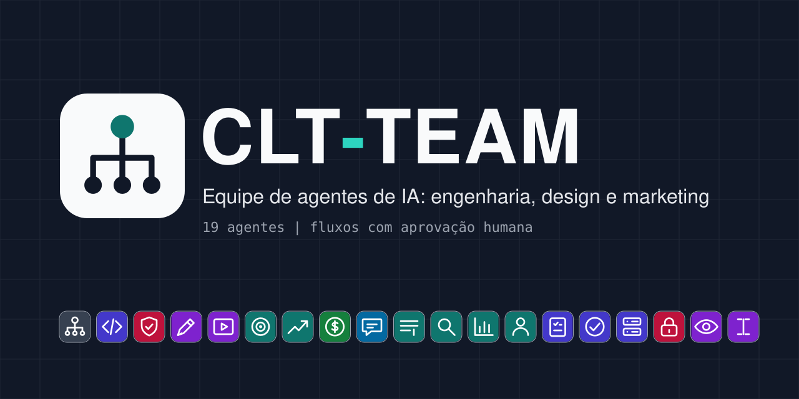

<p align="center">
  
</p>

<p align="center">
  
</p>

# CLT-TEAM

**Uma equipe completa de agentes de IA para o [Claude Code](https://docs.claude.com/en/docs/claude-code), com hierarquia, governança e aprovação humana.**

9 agentes principais e 10 sub-agentes cobrindo estratégia, engenharia, segurança, design, vídeo, marketing, mídia paga, finanças e redes sociais. Cada um sabe o que faz, o que **não** faz, a quem responde, quando precisa da sua aprovação e como devolver o trabalho para o próximo.

> **Isto é um template.** Os agentes são genéricos. Tudo o que é da sua empresa (entidades jurídicas, projetos, marcas, tetos de gasto, aprovadores) fica em um arquivo seu, `config/empresa.yaml`, que não vai para o repositório. Nenhum agente cria acesso, conta ou autorização: eles só usam as integrações que você conectar.

## Por que usar
- **Papéis claros, sem sobreposição.** Escopo "faz / não faz" em cada agente; fronteiras explícitas (ex.: COPYWRITER x UX WRITER, QA x SEGURANÇA).
- **Humano no circuito.** Gastar, publicar, enviar, apagar e fazer deploy crítico exigem a sua palavra de aprovação + código (padrão `APROVO`).
- **Separação por entidade jurídica.** Caixa, contas de anúncio, dados e marcas de CNPJs diferentes nunca se misturam; sistemas internos nunca viram produto à venda por acidente.
- **Evidência, não achismo.** Todo número com fonte e período; `observado`, `estimado`, `hipótese` e `não verificado` separados.
- **Proteções técnicas.** Sub-agentes com ferramentas em lista fechada e um hook que bloqueia exposição de segredos e alterações de produção.
- **Handoff padronizado.** Todo agente devolve no mesmo formato, para você (ou o próximo agente) agir.

## Organograma

<p align="center">
  
</p>

```
Proprietário (aprova A3)
└── socio
    ├── nerd ───────── produto · qa · sre
    ├── seguranca ──── privacidade
    ├── designer ───── editor* · ux-researcher · ux-writer
    ├── marketeiro ─── copywriter · seo · analista · crm
    ├── traficante
    ├── tesoureiro
    └── social-media
* editor é agente principal e responde tecnicamente ao designer
```

## Agentes

### Principais (convocados por `/equipe` e `/equipe-toda`)
| Agente | Slug | Em uma linha |
| --- | --- | --- |
| SÓCIO | `socio` | Cofundador crítico: triagem, prioridades, alternativas, delegação. |
| NERD | `nerd` | Staff engineer: arquitetura, código, testes e integrações sem fragmentar o legado. |
| SEGURANÇA | `seguranca` | AppSec e LGPD: threat modeling, segredos, isolamento, parecer apto/condicionado/bloqueado. |
| DESIGNER | `designer` | Design systems por marca e direção de arte (formas, tipografia, cor, motion). |
| EDITOR | `editor` | Vídeo: roteiro, montagem, legendas, áudio, render e QA. |
| MARKETEIRO | `marketeiro` | Growth: ICP, posicionamento, funil, experimentos. |
| TRAFICANTE | `traficante` | Tráfego pago (Google Ads, Meta Ads) dentro do teto aprovado. |
| TESOUREIRO | `tesoureiro` | FinOps: custos reais, conciliação, envelopes e alertas. |
| SOCIAL-MEDIA | `social-media` | Instagram orgânico: pauta, legendas, comentários e direct com aprovação. |

### Sub-agentes (só quando citados pelo nome)
| Sub-agente | Responde a | Em uma linha |
| --- | --- | --- |
| `copywriter` | marketeiro | Copy literal para LP, anúncios, VSL e testes A/B (rascunho). |
| `seo` | marketeiro | Conteúdo evergreen com intenção de busca e fontes datadas. |
| `analista` | marketeiro | Medição, UTMs e relatório do funil; somente leitura. |
| `crm` | marketeiro | Réguas de e-mail/WhatsApp com base legal e descadastro. |
| `produto` | nerd | SPEC com histórias, Gherkin, regras de negócio e fora de escopo. |
| `qa` | nerd | Testes reais, regressão e e2e; relatório reproduzível. |
| `sre` | nerd | Plano de release, migrações, backup, dry-run e verificação pós-deploy. |
| `privacidade` | seguranca | Minutas de LGPD: políticas, RIPD, ROPA, titulares, ANPD. |
| `ux-researcher` | designer | Concorrência, heurística, feedback e teste de usabilidade local. |
| `ux-writer` | designer | Microcopy: botões, erros, estados vazios, notificações. |

## Instalação rápida
```bash
git clone <url-deste-repositorio> clt-team
cd clt-team
./scripts/instalar.sh --simular   # mostra o que será copiado
./scripts/instalar.sh             # instala em ~/.claude (com backup do que já existir)
```
Depois, preencha `~/.claude/clt-team/config/empresa.yaml`. Instalação em um projeto só (`--projeto DIR`), cópia manual e desinstalação: [docs/GUIA-INSTALACAO.md](docs/GUIA-INSTALACAO.md).

| O quê | Vai para |
| --- | --- |
| `agents/*.md` | `~/.claude/agents/` (ou `<projeto>/.claude/agents/`) |
| `skills/*/SKILL.md` | `~/.claude/skills/` (ou `<projeto>/.claude/skills/`) |
| `docs/`, `hooks/`, `config/`, `registros/` | `~/.claude/clt-team/` |

## Uso
```text
/socio Quais três iniciativas devo pausar este trimestre?
/nerd meu-app Planeje o módulo de lembretes preservando os contratos.
/seguranca meu-app Revise o isolamento entre clientes.
/equipe meu-app Vale lançar plano anual?            # 2 a 4 especialistas
/equipe-toda meu-app Plano de lançamento completo   # os 9 principais
Peça ao qa para testar a branch feat/lembretes.     # sub-agente pelo nome
```
Para o SÓCIO fazer a triagem de todos os pedidos da sessão: `claude --agent socio`.
Mais exemplos por equipe: [docs/GUIA-USO.md](docs/GUIA-USO.md).

<p align="center">
  
</p>

## Documentação
| Documento | Conteúdo |
| --- | --- |
| [GOVERNANCA](docs/GOVERNANCA.md) | premissas, níveis A0–A3, responsabilidades, prioridades |
| [HIERARQUIA](docs/HIERARQUIA.md) | papéis, escopos, fronteiras, trilhas P/M/G |
| [PROTOCOLO-HANDOFF](docs/PROTOCOLO-HANDOFF.md) | como os agentes colaboram e o formato de retorno |
| [TEMPLATES](docs/TEMPLATES.md) | SPEC, QA, release, runbook, especificação de tela, ficha de direção de arte |
| [DESIGN-SYSTEMS](docs/DESIGN-SYSTEMS.md) | governança visual e vocabulário de direção de arte |
| [GUIA-INSTALACAO](docs/GUIA-INSTALACAO.md) | instalar, atualizar, desinstalar |
| [GUIA-CONFIGURACAO](docs/GUIA-CONFIGURACAO.md) | preencher `empresa.yaml`, integrações MCP |
| [GUIA-USO](docs/GUIA-USO.md) | exemplos de pedidos por equipe, como aprovar |
| [GUIA-SEGURANCA](docs/GUIA-SEGURANCA.md) | segredos, aprovações, LGPD, menor privilégio, lista fechada |
| [PLAYBOOK-INCIDENTES](docs/PLAYBOOK-INCIDENTES.md) | resposta a incidentes de segurança e dados |
| [CRIAR-NOVO-AGENTE](docs/CRIAR-NOVO-AGENTE.md) | como acrescentar um papel sem duplicar |
| [FAQ](docs/FAQ.md) | dúvidas frequentes |

## Avisos
- Template fornecido "como está" (licença MIT). Os agentes **não** substituem contador, advogado, encarregado de dados (DPO) nem auditoria de segurança profissional.
- Textos jurídicos gerados pelo agente `privacidade` são minutas.
- Revise as permissões das integrações que você conectar. Configure limites de gasto também nas próprias plataformas.

---

## English (short)
**CLT-TEAM** is a ready-to-adapt team of 19 Claude Code subagents (9 leads + 10 specialists) for strategy, engineering, security, design, video, marketing, paid media, FinOps and social media. It ships with governance (autonomy levels A0–A3), a standard handoff format, explicit human approval for spending/publishing/deploying (configurable keyword, default `APROVO`), per-legal-entity separation, closed tool lists for specialists and a `PreToolUse` hook that blocks secret exposure and production changes.

Prompts are in Brazilian Portuguese and reference Brazil's LGPD. Install with `./scripts/instalar.sh`, then fill in `~/.claude/clt-team/config/empresa.yaml` (never commit it). It is a **template**: it creates no accounts or permissions and only uses the integrations you connect. MIT licensed.

## Licença
[MIT](LICENSE) © CLT-TEAM contributors
